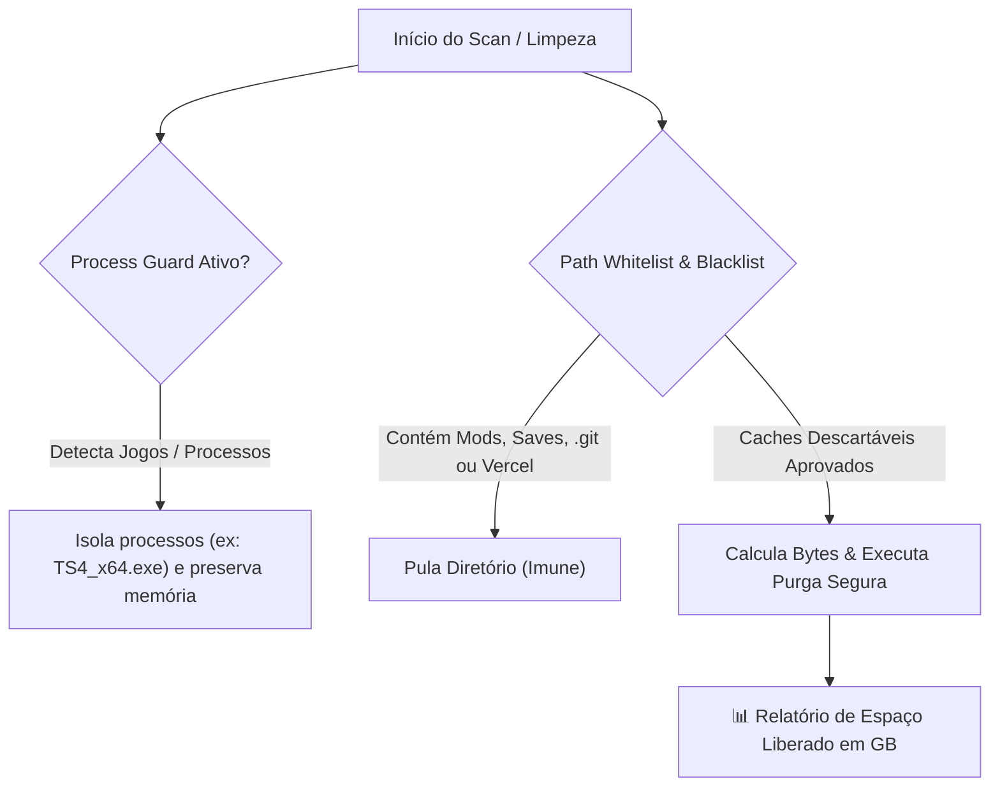

# 🧹 Dev Storage Cleaner — Limpador Seguro de Armazenamento para Desenvolvedores

<p align="center">
  
  
  
  
</p>

Ferramenta CLI e Dashboard Web de **higienização inteligente de espaço em disco e purga segura de caches de desenvolvimento** (NPM, Pip, Crash Dumps, resíduos temporários de instaladores e `%TEMP%`).

O sistema foi desenhado com **mecanismos de proteção estrita de processos e pastas (Process & Path Guard)**: garante que jogos em execução (como **The Sims 4 / EA**), mods, saves, repositórios de código ativo e ambientes de produção nunca sejam tocados ou interrompidos.

---

## 🛡️ Arquitetura de Segurança & Isolamento



---

## ⚡ Módulos de Limpeza Suportados

1. **📦 Cache do NPM / Node.js:** Purgador de tarballs e caches do `npm-cache` que acumulam gigabytes após sucessivos `npm install` e `npx`.
2. **🐍 Cache do Pip (Python):** Limpeza segura de wheels compiladas e arquivos temporários de ambiente.
3. **💥 Windows User Crash Dumps:** Remoção de arquivos `.dmp` de falhas passadas que ocupam espaço desnecessário no `%LOCALAPPDATA%\CrashDumps`.
4. **📁 Pastas Temporárias de Instaladores:** Detecção e remoção de pastas residuais de extração de instaladores (`_temp_*`).
5. **🗂️ Arquivos Temporários (%TEMP%):** Higienização de arquivos soltos sem travar processos que estejam usando arquivos em tempo real.

---

## 🚀 Como Utilizar

### 1. Clonar o repositório
```bash
git clone https://github.com/CauaRibeiroXY/dev-storage-cleaner.git
cd dev-storage-cleaner
```

### 2. Executar Varredura (Modo Seguro / Dry-Run)
Apenas escaneia o computador e calcula quanto espaço pode ser recuperado sem apagar nada:
```bash
python main.py --scan
```

### 3. Executar Limpeza Segura
Executa a purga de todas as categorias mapeadas mantendo seus jogos, saves e projetos 100% seguros:
```bash
python main.py --clean
```

### 4. Limpar Categoria Específica
```bash
python main.py --clean --category npm_cache
```

### 5. Iniciar Dashboard Visual Web
```bash
python main.py --web --port 5070
```
Acesse no navegador: **`http://localhost:5070`**.

---

## 📂 Estrutura do Repositório

```
dev-storage-cleaner/
├── core/
│   └── cleaner.py        # Motor de varredura, cálculo de bytes e process guard
├── web/
│   ├── templates/
│   │   └── index.html    # Dashboard web responsivo com Tailwind CSS
│   └── app.py            # Servidor Flask e endpoints REST de scan e clean
├── main.py               # Interface de linha de comando (CLI)
├── requirements.txt      # Dependências mínimas
└── README.md             # Documentação do projeto
```

---

## 👤 Autor

Desenvolvido por **[Cauã Ribeiro](https://github.com/CauaRibeiroXY)**  
*Acadêmico de Ciência da Computação (IFNMG) • AI Builder & Engenheiro de Software*
